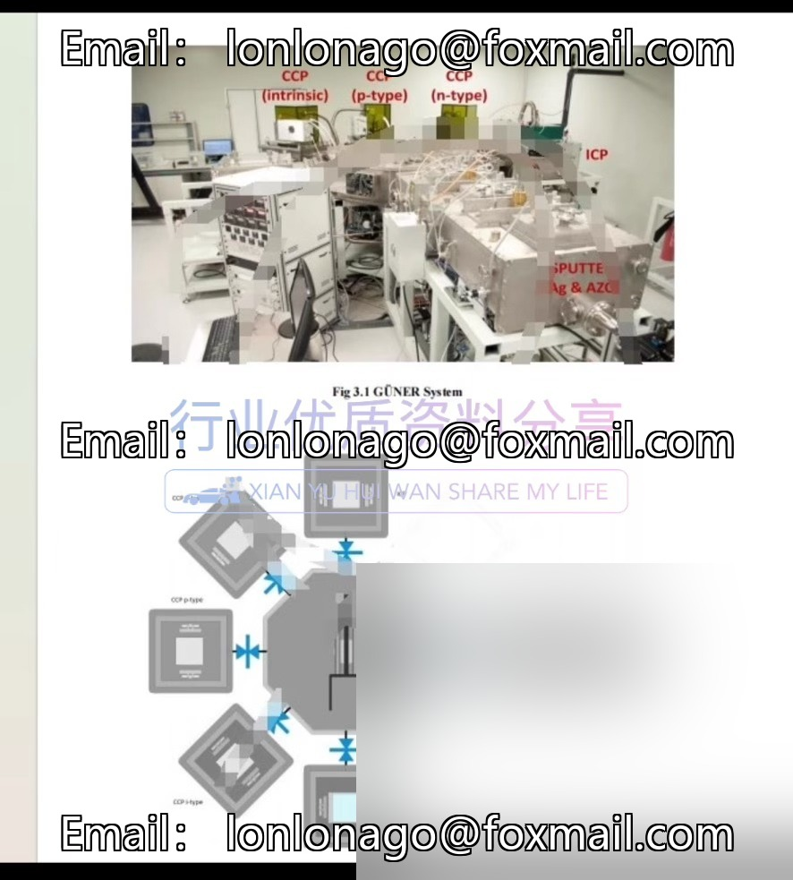
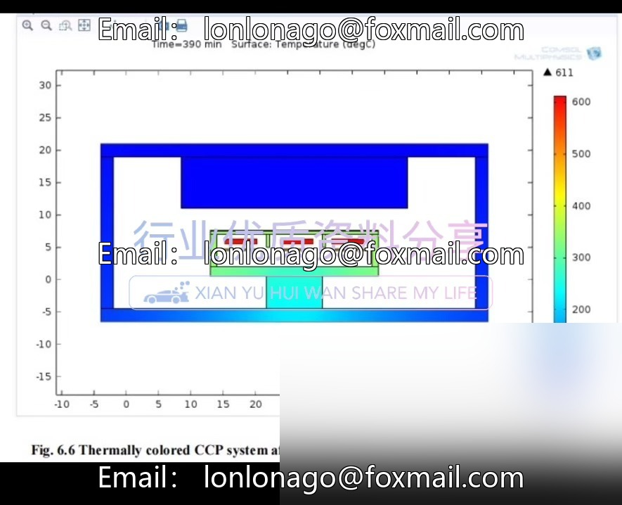
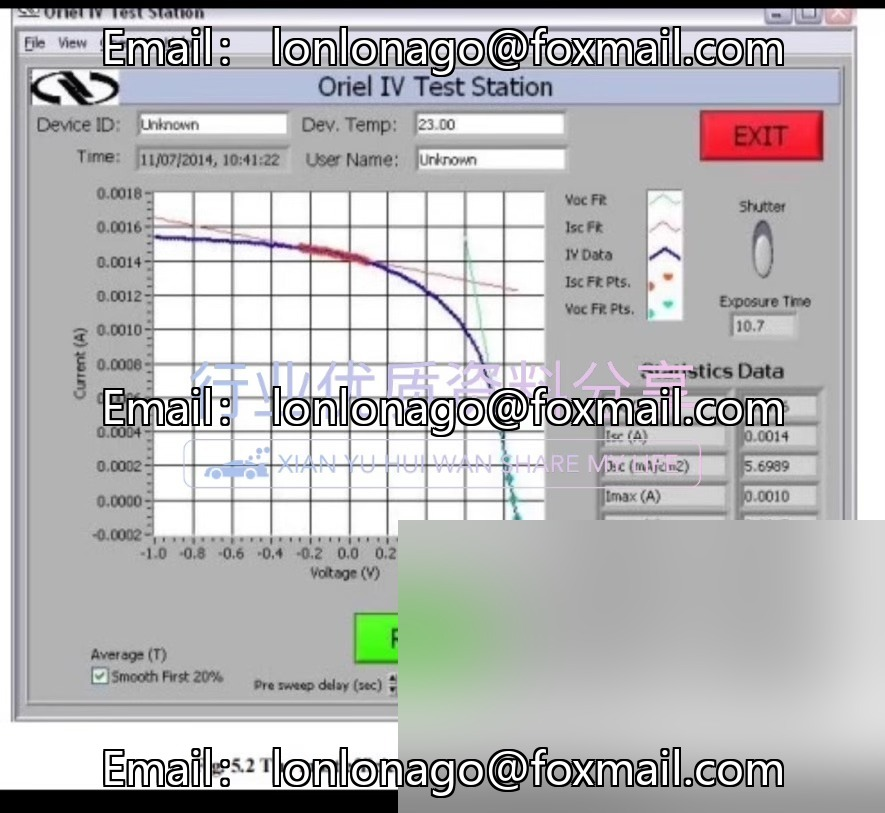
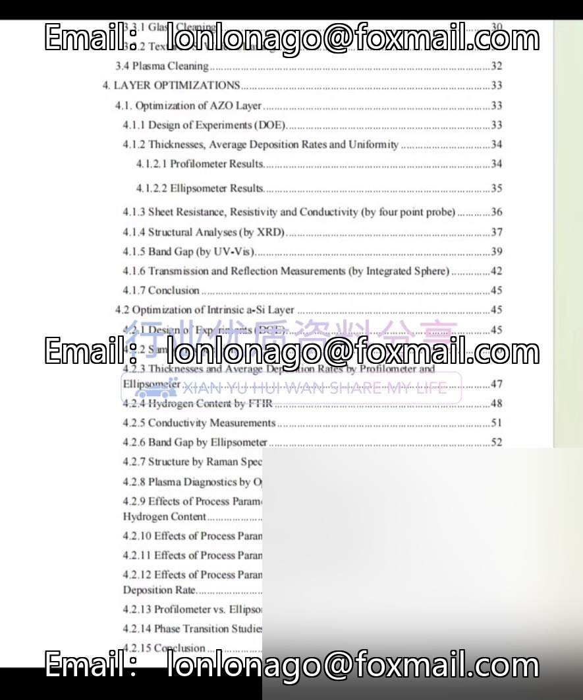

# PECVD technology internal research materials: research on process modeling and optimization as well as manufacturing

## Body

PECVD technical internal research materials: research and modeling of the process, as well as manufacturing technology and optimization, the manual has a total of 180 pages, containing large amounts of design calculations and verification processes, which is extremely valuable for the research on PECVD!!!

Upload directly to for electronic original files! The following image contains a screenshot of the file portion. Please confirm before placing an order! Because electronic file materials are copyable. So after purchase, no return is allowed! Thank you for understanding!

For personal learning and reference use only.

This is PECVD internal research covering flow modeling and optimization, manufacturing process technology, with an 180-page manual containing extensive design calculations and verification processes; the images show multiple technical parameters and tables.

<!-- AI_ENRICHED -->

## Images

## Payment

Here is a pay link on Stripe ( https://buy.stripe.com/3cs8yP7sY87d0vu9AB ). Please contact me lonlonago@foxmail.com after funding $89, and I will send you a complete data files , thank you!

